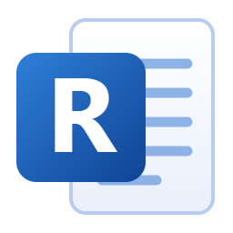
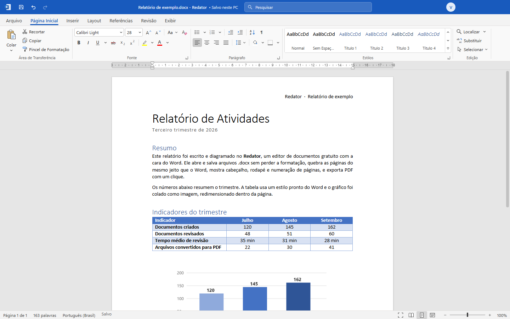
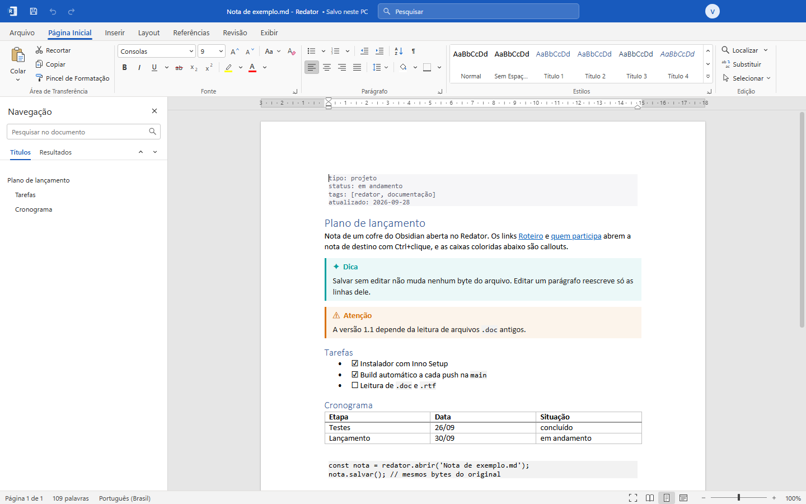
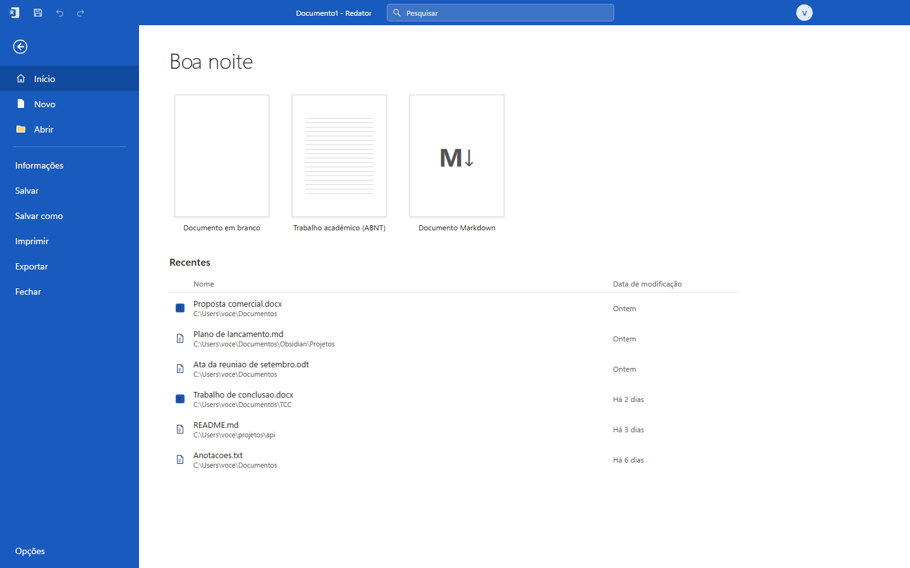
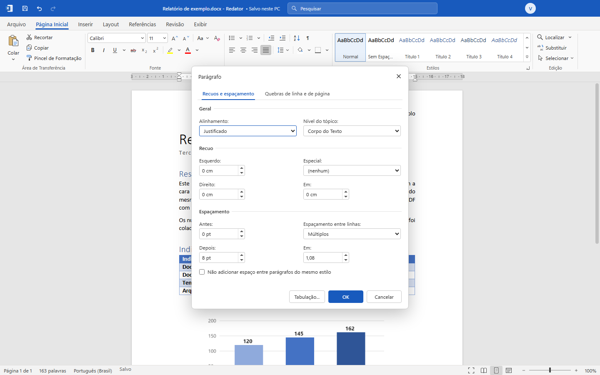

<p align="center">
  
</p>

<h1 align="center">Redator</h1>

<p align="center">
  Editor de documentos gratuito com a cara do Word.<br>
  Abre, edita e salva <b>.docx</b>, <b>.md</b>, <b>.odt</b>, <b>.rtf</b>, <b>.html</b> e <b>.txt</b>,<br>
  abre o <b>.doc</b> antigo e exporta <b>PDF</b>.
</p>

<p align="center">
  <a href="https://github.com/vinibotelho1998/Redator/actions/workflows/release.yml"></a>
  
  
  
  
</p>

<p align="center">
  
</p>

## O que ele faz

**Word de verdade na tela.** Faixa de opções, régua, zoom e painel de navegação
no mesmo lugar do Word. As páginas quebram como no Word, com cabeçalho, rodapé,
numeração "Página X de Y", notas de rodapé, sumário com pontilhado, tabelas com
estilos prontos, listas numeradas em vários níveis e imagens redimensionáveis.

**Salva sem estragar.** O `.docx` é lido e gravado em cima do pacote original: o
que o Redator não sabe editar, como gráficos, SmartArt e campos, volta para o
arquivo intacto. Abrir, mexer num parágrafo e salvar não bagunça o resto.

**Markdown sem diff fantasma.** Salvar um `.md` sem editar não muda nenhum byte.
Editar um parágrafo reescreve só as linhas dele, com o recuo, o marcador da lista
e a citação de antes. Entende o Obsidian: propriedades no topo, `[[links]]` que
abrem a nota com Ctrl+clique, anexos `![[imagem.png]]` e callouts coloridos.

**Rápido com arquivo grande.** Um log de 10 MB, com 170 mil linhas, abre e pagina
em poucos segundos, e a digitação continua fluida em documentos de centenas de
páginas.

**Corretor do Windows.** O sublinhado e as sugestões vêm do dicionário do próprio
sistema, em português, no clique com o botão direito.

**PDF que dá para editar.** Abre PDF como documento editável, igual o Word faz:
parágrafos, títulos com nível de estrutura, fontes, cores, links, listas, imagens e
tabelas com as bordas e o sombreamento, e o cabeçalho e o rodapé repetidos em cada
página voltam para o cabeçalho e o rodapé do documento, com o número da página.
Slides aparecem como imagens fiéis. Salvar grava um `.docx` ao lado do PDF.

**PDF e impressão.** Exporta PDF com as mesmas quebras de página da tela e imprime
pela janela de impressão do Windows.

**Nada se perde se o PC cair.** Enquanto há alterações não salvas, o Redator guarda
uma cópia a cada minuto. Se o programa fechar de repente, na abertura seguinte ele
oferece de volta tudo o que estava aberto, como a AutoRecuperação do Word.

<table>
  <tr>
    <td width="50%"></td>
    <td width="50%"></td>
  </tr>
  <tr>
    <td align="center">Nota do Obsidian com propriedades, links e callouts</td>
    <td align="center">Tela Arquivo com modelos, inclusive ABNT, e recentes</td>
  </tr>
  <tr>
    <td width="50%"></td>
    <td width="50%" valign="top">

**Atalhos do Word, nos dois padrões.** O padrão internacional usa Ctrl+B, Ctrl+I e
Ctrl+S. Quem vem do Word em português troca em Arquivo, Opções para Ctrl+N
negrito, Ctrl+S sublinhado e Ctrl+B salvar.

**Arquivos de texto intocados.** `.txt`, `.csv` e `.log` voltam com a mesma
codificação, o mesmo fim de linha e as mesmas tabulações.

**Leitor padrão.** O instalador registra o Redator no "Abrir com" do Windows e em
Aplicativos padrão, para `.docx`, `.doc`, `.pdf`, `.odt`, `.md`, `.rtf` e `.txt`. Como o Windows 11
não traz mais o WordPad, ele também serve para abrir os `.rtf` que sobraram.

</td>
  </tr>
</table>

## Formatos

| Formato | Abre | Salva |
|---|:---:|:---:|
| Documento do Word `.docx` `.docm` `.dotx` | ✅ | ✅ `.docx` |
| Texto OpenDocument `.odt` | ✅ | ✅ |
| Markdown `.md` `.markdown` | ✅ | ✅ |
| Página da Web `.html` `.htm` | ✅ | ✅ |
| Texto `.txt` `.csv` `.log` | ✅ | ✅ |
| Rich Text `.rtf` | ✅ | ✅ |
| Word 97-2003 `.doc` | ✅ | como `.docx` |
| PDF `.pdf` | ✅ editável | ✅ |

O `.doc` antigo abre em modo de compatibilidade, com títulos numerados, listas,
tabelas com células mescladas, imagens, links, sumário, notas de rodapé e
cabeçalho. Ao salvar, o Redator grava um `.docx` novo ao lado e não toca no
original.

## Instalação

Baixe o **Redator-Setup.exe** da [última release](https://github.com/vinibotelho1998/Redator/releases/latest)
e execute. Não pede administrador, não precisa de Node e nem do repositório.

O Windows não deixa um programa se declarar padrão sozinho. Para abrir documentos
com o Redator com dois cliques, clique com o botão direito num `.docx` ou `.md`,
escolha **Abrir com**, **Escolher outro aplicativo**, marque o **Redator** e
**Sempre**. Repita uma vez para cada extensão.

## Rodar a partir do código-fonte

Precisa do Node 22 ou mais novo no Windows.

```
npm install
npm start
```

## Testes

```
npm test
```

A bateria sobe o próprio Redator em modo de teste e confere, com arquivos de
exemplo em `tests/fixtures`:

- `.md` salvo sem edição igual byte a byte, inclusive com CRLF e BOM;
- `.md` editado mudando só as linhas editadas, e relido com a mesma estrutura;
- propriedades, callouts, `[[links]]` e anexos do Obsidian;
- `.txt` em Windows-1252 com tabulações voltando igual, e salvo como `.docx` com
  o estilo de texto simples;
- página da web salva abrindo sem botões, scripts e partes escondidas;
- PDF convertido na ordem de leitura, com títulos, tabela com as cores, gráfico e
  lista, e salvo como `.docx` válido;
- `.rtf` no formato do Word com acentos, listas, tabela, imagem, link, nota de
  rodapé, cabeçalho e rodapé, e a ida e volta mantendo texto e estrutura;
- recuperação automática devolvendo `.md`, `.rtf` e `.txt` com a edição, e a
  cópia apagada ao salvar;
- `.docx` gravado sem XML inválido e estável em ida e volta;
- exportação para `.odt`, `.html`, `.txt`, `.md` e `.rtf`;
- paginação e digitação num documento longo;
- botões da faixa de opções e caixas de diálogo sem erro.

## Gerar o instalador

```
BUILD.bat
```

Sai em `out\Redator-Setup.exe`. O CI gera um a cada push na `main` e publica na
release `latest`.

## Como funciona

- **Electron** para a janela, com a barra de título no azul do Word e o menu de
  contexto nativo do corretor ortográfico.
- **ProseMirror** para a edição. O modelo do documento espelha o WordprocessingML:
  propriedades de parágrafo e de caractere viram atributos e marcas, e o XML que
  não tem representação no editor fica guardado para voltar ao arquivo.
- **Layout de páginas próprio.** Mede as linhas de cada parágrafo e insere quebras
  de página com controle de linhas viúvas e órfãs, "manter com o próximo",
  cabeçalho, rodapé e notas de rodapé.
- **Markdown com mapa de origem.** Cada bloco lido guarda de que linhas veio. Na
  gravação, o que não mudou volta como estava e só o que mudou é reescrito.

## Onde ficam os dados

Preferências, arquivos recentes, tamanho da janela, palavras adicionadas ao
dicionário e as cópias da recuperação automática ficam em `%APPDATA%\Redator`.
O desinstalador pergunta antes de apagar.

## Licença

MIT. Veja [LICENSE](LICENSE).

O Redator usa Electron, ProseMirror, markdown-it e JSZip, cada um sob a própria
licença MIT.
